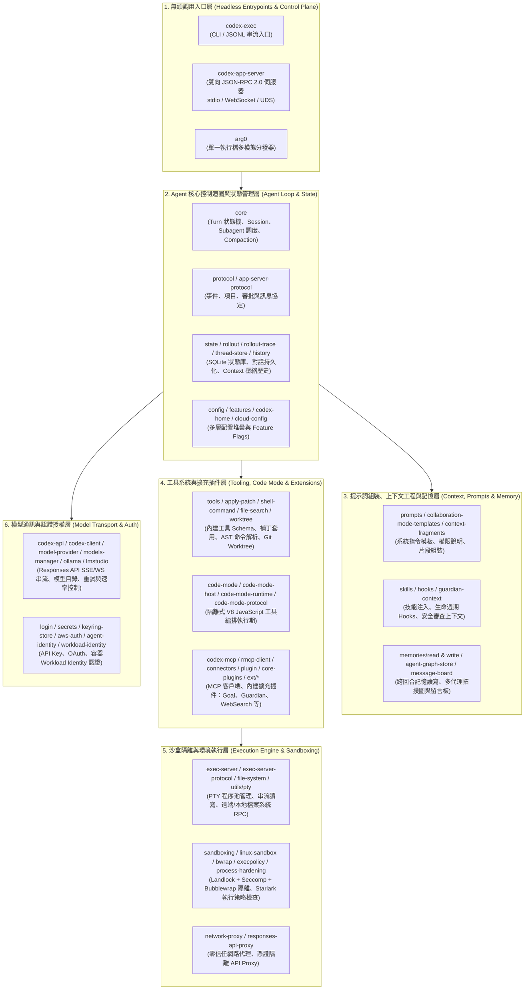

# Codex Agent Harness 架構說明與模組保留依據

本文件說明為什麼本倉庫留下的模組屬於 **Codex Agent Harness** 核心，並詳述其七大架構分層、剔除的非 Harness 元件，以及如何在 Docker Sandbox 中部署與調用。

---

## 1. 什麼是 Agent Harness？（在 Codex 原始碼中的定義）

在 AI Coding Agent 系統設計中，**Model（模型）** 只負責根據輸入的 Context Window 產生 Token（包含推理 Reasoning 與 Tool Call 意圖）；而 **Agent Harness（代理執行框架／控制底座）** 則是圍繞在模型外圍、負責讓模型具備「自主感知環境、安全執行工具、管理長程狀態與多代理協作」的完整控制迴圈（Control Loop）與執行環境。

在 Codex 原始碼中，`Harness` 是一個一等公民（First-class）的架構概念：

- **Prompt 與系統指令層**（`codex-rs/core/gpt_5_2_prompt.md`、`codex-rs/protocol/src/prompts/base_instructions/default.md`）：明確定義模型透過 **Harness** 接收工作區上下文與工具回饋。
- **上下文來源追蹤**（`codex-rs/protocol/src/models/item_metadata.rs` 中的 `ContentItemProvenance::Harness` 與 `codex-rs/history/src/lib.rs` 中的 `CodexHarnessMetadata`）：區分哪些訊息是由使用者輸入、哪些是由工具回傳、哪些是由 **Harness 本身注入的控制指令或配置變更**（`harness_authored_configuration`），防止 Prompt Injection 偽造系統配置。
- **工具命名空間歸屬**（`codex-rs/core/src/tools/tool_namespaces_info.rs` 中的 `TurnToolSource::Harness`）：區分內建於 Harness 的原生工具（Shell、Apply Patch、Code Mode、Subagent）與外部動態掛載的 MCP 工具。
- **配置優先級覆寫**（`codex-rs/core/src/config/mod.rs` 中的 `harness_overrides`）：允許啟動 Harness 的宿主（如 Docker Entrypoint 或 Orchestrator）強制鎖定沙盒策略（Sandbox Policy）與審批策略（Approval Policy）。

---

## 2. 為什麼留下的區塊屬於 Harness？（七大架構分層解析）

保留在 `codex-rs/` 下的模組構成了**無頭（Headless）可獨立編譯與執行的完整 Agent Harness 閉包**，共分為以下七個核心層次：



### 第 1 層：無頭調用入口層（Headless Entrypoints & Control Plane）

這一層是外部系統（Docker 容器外部的 Orchestrator、CI Pipeline 或後端服務）調用 Harness 的控制面入口：

| 保留目錄 (`codex-rs/`) | 為什麼屬於 Harness |
| :--- | :--- |
| `exec` (`codex-exec`) | **單次／批次非互動式 Harness 入口**。將 Prompt 轉為 Agent Turn，支援 `--json` 輸出結構化 JSONL 事件流（`thread.started`、`item.started`、`item.completed`、`turn.completed`），是容器化自動化任務最直接的 CLI 介面。 |
| `app-server`、`app-server-transport`、`app-server-daemon`、`app-server-client`、`app-server-protocol`、`app-server-protocol-noop-macros` | **常駐型雙向 JSON-RPC 2.0 Harness 伺服器**。支援 `--listen ws://0.0.0.0:8080`、`stdio://` 與 `unix://`，讓外部程式能以非同步 RPC 控制多輪對話（Thread Start/Resume/Fork/Interrupt）、串流接收推理與工具輸出、注入動態工具（Dynamic Tools），以及攔截並回覆工具審批（Approval Callbacks）。 |
| `arg0`、`install-context` | **單一執行檔多模態分發器（Arg0 Trick）**。當 Harness 啟動子程序時，會透過執行檔別名（Symlink）或隱藏參數（如 `codex-linux-sandbox`、`apply_patch`、`--codex-run-as-fs-helper`）自我調用（Re-exec），讓沙盒與檔案系統 Helper 不必依賴外部環境預裝。 |

---

### 第 2 層：Agent 核心控制迴圈與狀態管理層（Core Agent Loop & State）

這是 Harness 的大腦，負責驅動 `Model Request -> Tool Call Parsing -> Approval/Policy Check -> Sandbox Execution -> Observation Injection -> Next Model Turn` 的閉環：

| 保留目錄 (`codex-rs/`) | 為什麼屬於 Harness |
| :--- | :--- |
| `core` | **Harness 核心引擎**。實作 `CodexThread`、`ThreadManager`、Turn 狀態機、工具路由分發、Context Compaction（上下文自動壓縮）、`AGENTS.md` 探索載入，以及多代理（Subagent）產生與生命週期管理。 |
| `protocol` (`+ protocol/tests/support`) | **Harness 內部核心資料結構與合約**。定義 `UserInput`、`ResponseItem`、`AskForApproval`、`SandboxMode`、`PermissionProfile` 與 `ContentItemProvenance::Harness` 等跨模組協定。 |
| `history`、`rollout`、`rollout-trace`、`state`、`thread-store`、`attachment-store` | **對話歷史與狀態持久化引擎**。負責記錄每個 Turn 的完整事件軌跡（Rollout JSONL 與 SQLite State DB）、支援從任意 Turn 恢復（Resume）或分叉（Fork），並維護 `CodexHarnessMetadata` 以驗證歷史記錄中系統配置的真實性。 |
| `config`、`features`、`codex-home`、`cloud-config` | **多層配置解析與特性開關**。將系統層、專案層（`.codex/`）、使用者層與 CLI `-c key=value` / `harness_overrides` 合併為最終生效的沙盒與模型配置。 |

---

### 第 3 層：提示詞組裝、上下文工程與記憶層（Context, Prompts & Memory）

模型本身沒有狀態，Harness 必須在每一輪請求前精準構造 Context Window：

| 保留目錄 (`codex-rs/`) | 為什麼屬於 Harness |
| :--- | :--- |
| `prompts`、`collaboration-mode-templates`、`context-fragments` | **動態系統提示詞組裝器**。根據當前的 `SandboxMode`（如 `workspace-write`、`read-only`）與 `ApprovalPolicy` 動態生成模型可見的權限邊界說明與協作模式（Plan / Default）指令。 |
| `skills`、`hooks`、`guardian-context` | **技能系統與生命週期攔截器**。`skills` 負責按需載入 `SKILL.md` 領域知識；`hooks` 在 `SessionStart`、`PreToolUse`、`PostToolUse`、`Stop` 等節點執行外部驗證腳本並將結果以 `HookContext::harness` 注入上下文。 |
| `memories/read`、`memories/write`、`agent-graph-store`、`agent-roles`、`agent-message-board-client`、`message-board` | **跨回合記憶與多代理協作層**。當主 Agent 派生多個 Subagent 平行處理任務時，透過 `agent-graph-store` 追蹤代理樹狀關係，並透過 `message-board` 進行非同步代理間通訊。 |

---

### 第 4 層：工具系統、Code Mode 與擴充插件層（Tooling, Code Mode & Extensions）

Harness 賦予模型操作外部世界的能力（Tools）：

| 保留目錄 (`codex-rs/`) | 為什麼屬於 Harness |
| :--- | :--- |
| `tools`、`apply-patch`、`shell-command`、`file-search`、`file-watcher`、`worktree`、`git-utils` | **原生核心工具集**。包含模型專用的 `apply_patch` 語法解析與差異套用器、基於 Tree-sitter（Bash/PowerShell）的命令語法樹安全分析（`shell-command`）、高速檔案檢索（`file-search`）與隔離式 Git Worktree 管理。 |
| `code-mode`、`code-mode-host`、`code-mode-protocol`、`code-mode-runtime` | **Code Mode（V8 隔離執行期）**。允許模型編寫一段 JavaScript/TypeScript 腳本來批次編排多個工具呼叫與資料處理，由 `code-mode-host` 在獨立的 V8 Isolate 子程序中安全執行，大幅減少多輪 Tool Call 的延遲與 Token 消耗。 |
| `codex-mcp`、`rmcp-client`、`connectors`、`plugin`、`core-plugin-common`、`core-plugins`、`external-agent-migration` | **Model Context Protocol (MCP) 與插件框架**。讓 Harness 能連接外部 stdio / Streamable HTTP MCP Server，並把外部工具安全地映射進模型的工具清單。 |
| `ext/*`（保留 `agent`、`agent-message-board`、`connectors`、`extension-api`、`git-attribution`、`goal`、`guardian-reviewer`、`guardian-v2`、`history-notes`、`image-generation`、`items`、`mcp`、`memories`、`multi-env-copy-file`、`queue`、`skills`、`web-search`） | **Harness 內建模組化擴充（Extensions）**。特別是 `guardian-reviewer` / `guardian-v2`（自動安全審查高風險工具呼叫）與 `goal`（長程目標自動續行控制），皆透過 `extension-api` 掛載於 `codex-core` 與 `codex-app-server` 上。 |

---

### 第 5 層：沙盒隔離、執行策略與環境執行層（Execution Engine & Sandboxing）

這是讓 Harness 能在本地或 Docker 容器內安全執行不可信命令的防線：

| 保留目錄 (`codex-rs/`) | 為什麼屬於 Harness |
| :--- | :--- |
| `exec-server`、`exec-server-protocol`、`file-system` | **環境執行器（Environment Executor）**。負責管理 PTY 與背景子程序池（`process/start`、`process/write`、`process/read`、`process/terminate`）及沙盒化檔案系統操作（`fs/readFile`、`fs/writeFile` 等）。既可由 `codex-core` 在同行程內呼叫，也能獨立啟動為遠端執行容器。 |
| `sandboxing`、`linux-sandbox`、`bwrap`、`vendor/bubblewrap`、`windows-sandbox-rs`、`mxc-sandbox`、`process-hardening` | **作業系統級別的多層沙盒**。在 Linux/Docker 環境下，`linux-sandbox` 與內嵌的 `bwrap`（Bubblewrap）結合 **Landlock LSM**、**Seccomp BPF 系統呼叫過濾**與 **Namespace 隔離**，限制子程序只能寫入允許的工作區路徑，並透過 `process-hardening` 防止 `ptrace` 注入或 Core Dump 洩漏憑證。 |
| `execpolicy` | **Starlark 宣告式執行策略引擎**。解析 `.codex/policy` 規則，在執行任何 Shell 命令前根據命令參數樹判定 `allow`、`prompt` 或 `forbidden`。 |
| `network-proxy`、`responses-api-proxy` | **零信任網路與憑證隔離代理**。`network-proxy` 攔截沙盒內子程序的外連請求並依網域白名單（`NetworkDomainPermissions`）過濾；`responses-api-proxy` 則讓容器內的處理程序無需持有原始 `OPENAI_API_KEY`，由代理層代為注入 Header 轉發至 OpenAI API。 |

---

### 第 6 層：模型通訊與認證授權層（Model Transport & Auth）

| 保留目錄 (`codex-rs/`) | 為什麼屬於 Harness |
| :--- | :--- |
| `codex-api`、`codex-client`、`http-client`、`websocket-client`、`websocket-auth`、`model-provider`、`model-provider-info`、`models-manager`、`backend-client`、`codex-backend-openapi-models`、`chatgpt`、`ollama`、`lmstudio` | **多供應商模型傳輸層**。實作 OpenAI Responses API（HTTP SSE 與 WebSocket 雙向串流）、本地開源模型（Ollama / LM Studio）適配、自動重試退避（Retry/Backoff）與模型能力目錄（`models.json`）。 |
| `login`、`secrets`、`keyring-store`、`aws-auth`、`agent-identity`、`workload-identity`、`user-verification` | **認證與容器身分管理**。支援 `OPENAI_API_KEY` / `CODEX_API_KEY`、AWS SigV4，以及容器化環境專用的 `CODEX_ACCESS_TOKEN` Agent Identity / Workload Identity 憑證交換。 |

---

### 第 7 層：基礎設施、可觀測性與底層工具庫（Observability & Runtime Utilities）

- **可觀測性與診斷**：`otel`、`otel-trace-websocket`、`analytics`、`diagnostics`、`feedback`、`response-debug-context`（提供 OpenTelemetry 分散式追蹤，支援將容器內每次 Turn 與 Tool Call 的 Span 匯出至外部 Collector）。
- **底層跨平台工具庫**：`async-utils`、`build-info`、`codex-experimental-api-macros`、`terminal-detection`、`uds`（Unix Domain Socket），以及 `utils/*` 下的 `absolute-path`、`audio`、`cache`、`cargo-bin`、`cli`、`git-discovery`、`head-tail-buffer`、`home-dir`、`image`、`json-to-toml`、`oss`、`output-truncation`（防止超長命令輸出塞爆模型 Context）、`path-uri`、`path-utils`、`plugins`、`process`、`pty`（偽終端機管理）、`redacted-string`（日誌敏感資訊遮罩）、`rustls-provider`、`sandbox-summary`、`stream-parser`、`string`、`template`。

---

## 3. 被移除的非 Harness 區塊（為什麼它們不屬於 Harness）

為了讓專案專注於作為 **Docker Sandbox 內的無頭 Agent Harness**，我們移除了所有「終端使用者互動介面（UI）」、「桌面端／語音硬體整合」、「外部語言包裝 SDK」與「Monorepo 發佈腳本」：

| 已移除的目錄／Crate | 移除原因（為何不屬於 Harness） |
| :--- | :--- |
| `codex-rs/tui`、`ansi-escape`、`mermaid`、`message-history`、`utils/approval-presets`、`utils/elapsed`、`utils/fuzzy-match`、`utils/sleep-inhibitor` | **互動式終端機介面（Ratatui TUI）**。負責畫面渲染、鍵盤快捷鍵、模糊檔案選單、Mermaid 圖表渲染與防筆電休眠，屬於純前端展示層，在無頭 Docker Sandbox 中完全不需要。 |
| `codex-rs/cli`、`stdio-to-uds`、`tcp-tunnel`、`app-server-test-client` | **桌面端多合一入口包裝器**。原 `codex-cli` 捆綁了 `codex-tui`、macOS/Windows 桌面版 App 安裝器（`desktop_app.rs` / `app_cmd.rs`）與 Cloud TUI 瀏覽器。移除後，Docker 內直接由輕量腳本 `/usr/local/bin/codex` 分發至無頭的 `codex-exec`、`codex-app-server` 與 `exec-server`。 |
| `codex-rs/cloud-client`、`cloud-tasks`、`cloud-tasks-client`、`cloud-tasks-mock-client` | **Codex Cloud 遠端任務互動式瀏覽器（`codex cloud`）**。僅供開發者在本地終端機瀏覽雲端任務並套用 Diff，不參與本地或容器內的 Agent 執行迴圈。 |
| `codex-rs/voice-host`、`realtime-webrtc` | **桌面語音通話與 WebRTC 音訊主機**。負責麥克風擷取與即時語音互動，不屬於程式碼沙盒 Harness。 |
| `codex-rs/v8-poc`、`thread-manager-sample`、`config-schema`、`core-api`、`direct-tool-timing`、`ext/guardian-v3`、`runtime-agent-instance`、`windows-sandbox-service`、`utils/critical-path`、`utils/readiness` | **未接線的實驗性 PoC、範例程式、CI Schema 產生器與 Windows 專屬背景服務安裝器**，不在任何 Harness 執行路徑的依賴閉包中。 |
| 根目錄 `sdk/`、`codex-cli/`、`bazel/`、`third_party/`、`patches/`、`tools/`、`scripts/`、`docs/`、`.github/` | **外部客戶端 SDK（Python/TS）、npm/Winget 發佈包裝、Bazel 建置系統與 GitHub CI 工作流**。移除後可直接使用標準 `cargo build` 或 `docker build` 建置純淨的 Harness 映像檔。 |

---

## 4. 在 Docker Sandbox 中啟動與調用 Harness

本倉庫已配置好完整的多階段 [`Dockerfile`](./Dockerfile)、[`docker-compose.yml`](./docker-compose.yml) 與沙盒啟動腳本 [`docker/run_in_sandbox.sh`](./docker/run_in_sandbox.sh)。

### 4.1 建置 Docker Sandbox 映像檔

```bash
docker build -t codex-harness:latest .
```

映像檔內建以下核心執行檔（位於 `/usr/local/bin/`）：
- `codex`：統一無頭入口（支援 `codex exec`、`codex app-server`、`codex exec-server`）
- `codex-exec`：單次／批次非互動式 Agent Harness（支援 `--json` JSONL 事件流輸出）
- `codex-app-server`：雙向 JSON-RPC 2.0 Harness 伺服器（支援 `ws://`、`stdio://`、`unix://`）
- `exec-server`：純環境執行器伺服器（提供 PTY 與檔案系統 JSON-RPC）
- `codex-linux-sandbox` & `bwrap`：Linux Landlock + Seccomp + Bubblewrap 沙盒隔離器
- `apply_patch`、`codex-execpolicy`、`codex-code-mode-host`、`codex-responses-api-proxy`

---

### 4.2 調用方式一：CLI / JSONL 串流模式（`codex-exec`）

適合單次任務委派、CI/CD 自動化修復，或由外部程式透過 `docker run -i` 讀取 stdout 的 JSONL 事件流：

```bash
# 直接掛載宿主機目標專案至容器 /workspace，並以 JSONL 串流輸出每個推理與工具執行步驟
docker run --rm -i \
  --security-opt seccomp=unconfined \
  -e OPENAI_API_KEY="$OPENAI_API_KEY" \
  -v "$(pwd):/workspace" \
  -w /workspace \
  codex-harness:latest \
  exec --json --full-auto --skip-git-repo-check "檢查專案結構並修復失敗的測試"
```

若要同時啟用容器內的 **iptables / ipset 網域白名單防火牆**（僅允許連線至 `api.openai.com`，封鎖一切其他外連），可使用 [`docker/run_in_sandbox.sh`](./docker/run_in_sandbox.sh)：

```bash
./docker/run_in_sandbox.sh \
  --work-dir /path/to/target-repo \
  --firewall \
  -- --json --full-auto --skip-git-repo-check "實作需求並執行單元測試"
```

---

### 4.3 調用方式二：雙向 JSON-RPC 2.0 服務模式（`codex-app-server`）

適合需要**長連線、多輪對話（Multi-turn Thread）、即時串流、中途插話（Steer / Interrupt）或自訂工具審批**的外部 Orchestrator 調用：

#### A. 透過 WebSocket 啟動（`ws://0.0.0.0:8080`）

```bash
# 使用 docker compose 啟動常駐 Harness 服務
OPENAI_API_KEY="$OPENAI_API_KEY" WORKSPACE_DIR=/path/to/target-repo \
  docker compose up -d codex-app-server
```

或直接使用 `docker run`：

```bash
docker run --rm -d \
  --name codex-sandbox \
  --security-opt seccomp=unconfined \
  -p 8080:8080 \
  -e HARNESS_MODE=app-server \
  -e HARNESS_LISTEN_URL=ws://0.0.0.0:8080 \
  -e OPENAI_API_KEY="$OPENAI_API_KEY" \
  -v "/path/to/target-repo:/workspace" \
  codex-harness:latest
```

啟動後，外部服務即可連線至 `ws://localhost:8080` 發送標準 JSON-RPC 請求：
1. `initialize` -> `initialized`
2. `thread/start`（建立對話與設定 `cwd`、`sandbox`、`approvalPolicy`）
3. `turn/start`（傳入使用者 Prompt 或圖片，並透過 WebSocket 串流接收所有 `item/*` 與 `turn/*` 通知）

#### B. 透過 `stdio://` 管線調用

若宿主機程式希望直接透過 Subprocess Pipe 控制容器內的 `codex-app-server`：

```bash
docker run --rm -i \
  --security-opt seccomp=unconfined \
  -e OPENAI_API_KEY="$OPENAI_API_KEY" \
  -v "/path/to/target-repo:/workspace" \
  codex-harness:latest \
  app-server --listen stdio://
```

---

### 4.4 調用方式三：純沙盒執行伺服器模式（`exec-server`）

若你希望將 Agent 控制迴圈跑在容器外，僅將 Docker 容器作為隔離的命令與檔案執行環境（Sandbox Executor）：

```bash
docker run --rm -d \
  --name codex-exec-sandbox \
  --security-opt seccomp=unconfined \
  -p 31987:31987 \
  -e HARNESS_MODE=exec-server \
  -e EXEC_SERVER_LISTEN_URL=ws://0.0.0.0:31987 \
  -v "/path/to/target-repo:/workspace" \
  codex-harness:latest
```

外部的 `codex-exec` 或 `codex-app-server` 只需設定環境變數：

```bash
CODEX_EXEC_SERVER_URL=ws://127.0.0.1:31987 codex-exec -C /workspace "在容器沙盒內執行建置與測試"
```
